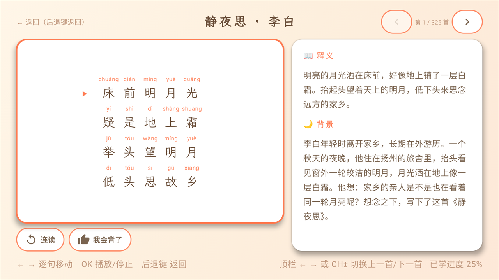
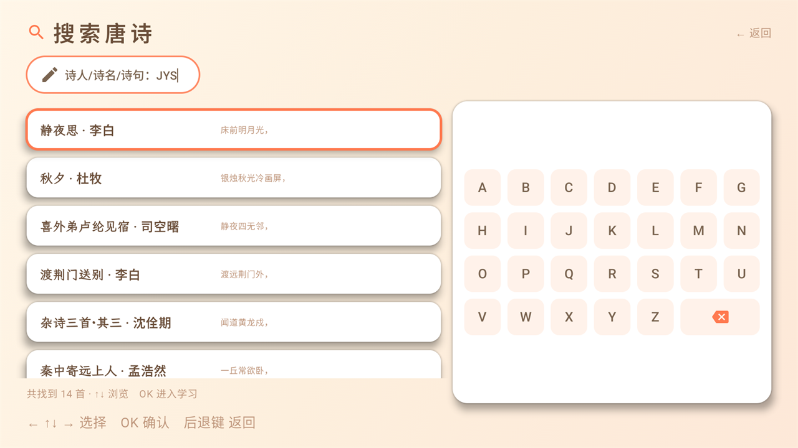
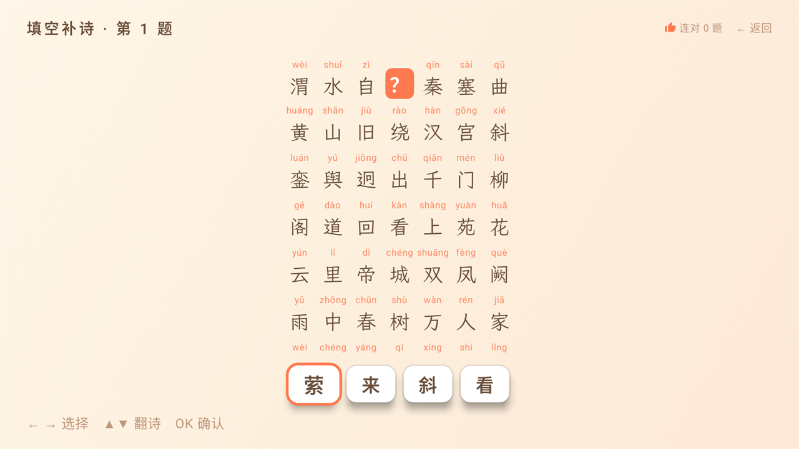

# 唐诗三百首 · Android TV

> 家庭客厅里的唐诗启蒙应用 —— 遥控器操作、完全离线、325 首诗逐字拼音 + 逐句语音朗读 + 背诗小游戏。


[](LICENSE)

## 目录

- [简介](#简介)
- [页面截图](#页面截图)
- [功能特性](#功能特性)
- [技术栈](#技术栈)
- [快速开始](#快速开始)
- [按键操作](#按键操作)
- [项目结构](#项目结构)
- [数据与语音包](#数据与语音包)
- [内容生产工具链](#内容生产工具链)
- [测试](#测试)
- [文档](#文档)
- [已知限制](#已知限制)
- [许可与第三方内容](#许可与第三方内容)

## 简介

面向学龄前与小学低年级儿童的唐诗学习应用，定位**家庭客厅 + 电视遥控器**场景：孩子跟着语音逐句跟读，家长在旁讲解创作背景，学完几首后玩「填空补诗 / 听音辨诗」小游戏巩固。

- 内容为通行本《唐诗三百首》（蘅塘退士编）清洗后的 **325 首**（76 位诗人、3216 句），含逐字拼音与口语化创作背景。
- **完全离线**：诗句数据、拼音、语音全部随 APK 打包，运行期不联网、无账号、无广告，也不采集任何数据。
- 单学习档案（不做多孩子档案），进度与连续天数本地持久化。

## 页面截图

均为 Release 包在 Android TV 模拟器（1920×1080）上的实机截图。

| | |
|---|---|
| <br>**首页** —— 当前学习大卡、三项统计、四个入口 | <br>**诗学习详情页** —— 逐字拼音、整句高亮、连读与「我会背了」 |
| <br>**搜索** —— 输入 `JYS` 即命中《静夜思》，右侧为屏幕键盘 | <br>**全部唐诗** —— 4×2 分页网格，卡片带进度徽章 |
| <br>**背诗小游戏** —— 选玩法与题目范围 | <br>**填空补诗** —— 挖字选字，缺字处显示 `?` |
| <br>**听音辨诗** —— 听朗读选诗名，可重听 3 次 | <br>**家长设置** —— 按键提示音、清除学习进度 |

## 功能特性

| 页面 | 能力 |
|---|---|
| 首页 | 当前学习诗大卡（诗名 + 诗人 + 前几句预览 + 诵读进度条，整卡一个焦点落点）、已学唐诗 / 连续学习 / 已会背诵三项统计、搜索 / 全部唐诗 / 背诗小游戏 / 家长设置四入口 |
| 诗学习详情页 | 逐字拼音（ruby 式排版）、当前朗读句整句高亮、`连读` 开关（开=整首循环、末句回卷句首；关=朗读箭头所指单句）、`👍 我会背了`、创作背景故事卡；顶栏 `◀ ▶` 或 `CH±` 切换上一首/下一首 |
| 搜索 | 诗人筛选（按拼音排序、含收录诗数）+ 屏幕键盘关键字；关键字同时命中汉字与全拼/首字母（输入 `jingyesi` 或 `JYS` 都能搜到《静夜思》） |
| 全部唐诗 | 4×2 分页网格，按 `全部 / 未学习 / 学习中 / 已会背` 筛选，卡片带进度徽章 |
| 背诗小游戏 | 两种玩法：**填空补诗**（挖字选字）、**听音辨诗**（听音频选诗名）；10 题一轮、三星结算；题池按 `已学全部（默认）/ 全部` 切换 |
| 家长设置 | 按键提示音开关、清除学习进度（二次确认，默认焦点=保留），底栏显示版本与数据来源 |

边界行为（均经实机验证）：

- **后台暂停而非停止**：播放中按主页键 / 切应用 / 息屏 → 暂停，回前台从当前句续播，屏幕上的「第 N 句」不断档。
- **播放期间屏幕常亮**：有音频装载期间给窗口挂 `FLAG_KEEP_SCREEN_ON`，避免屏保打断整首连读。
- 长诗（最长《长恨歌》120 句）题面可纵向滚动，缺字句自动进入视口。
- 音频缺失/损坏时静默降级并提示，不崩溃。
- 详情页「连读」开关状态落家长设置 `DataStore`（键 `loopEnabled`），跨进屏、跨进程重启均记忆。

## 技术栈

| 项 | 选择 |
|---|---|
| 语言 / UI | Kotlin 2.1.20 + Jetpack Compose（`androidx.compose.material3` + `androidx.tv:tv-material` 1.1.0） |
| 播放 | Media3 ExoPlayer 1.5.1（逐句单文件播放 + 播放列表连读循环） |
| 持久化 | Room 2.6.1（仅学习进度）+ DataStore 1.1.1（家长设置） |
| 序列化 / 导航 | kotlinx.serialization 1.7.3、Navigation Compose 2.8.5 |
| 构建 | AGP 8.7.3、Gradle 8.11.1（wrapper）、JDK 17、KSP |
| 设备 | `minSdk 23` / `targetSdk 35` / `compileSdk 35`，`android.software.leanback` 必需，包名 `com.rakor.tangshi` |

架构为单 Activity + Compose Navigation，路由：`home` / `poem/{id}` / `search` / `library` / `gameSetup` / `game/{mode}` / `gameResult` / `settings`；依赖注入由轻量的 `di/AppGraph` 手工装配，无 DI 框架。

## 快速开始

**环境要求**：JDK 17、Android SDK Platform 35，以及一台 Android TV / TV 模拟器（或支持 leanback 的设备）。

```powershell
# 克隆
git clone https://github.com/caopengfei/tangshi.git
cd tangshi

# Debug 构建 / 安装到已连接设备
.\gradlew.bat assembleDebug
.\gradlew.bat installDebug
```

macOS / Linux 把 `.\gradlew.bat` 换成 `./gradlew`。产物路径：`app/build/outputs/apk/debug/app-debug.apk`。

**Release 签名**：在仓库根目录放置 `keystore.properties`（已在 `.gitignore` 中，不会入库）：

```properties
storeFile=../your.keystore
storePassword=******
keyAlias=******
keyPassword=******
```

```powershell
.\gradlew.bat assembleRelease
```

文件缺失时 release 自动回退 debug 签名，保证任何环境都能出包。

## 按键操作

| 按键 | 行为 |
|---|---|
| `▲ ▼ ◀ ▶` | 焦点移动（网格 / 胶囊 / 键盘）；详情页诗行区 `◀ ▶` 逐句移动，顶栏 `◀ ▶` 或 `CH±` 切上一首/下一首；长诗题面 `▲ ▼` 翻诗 |
| `OK` | 确认 / 选中；详情页播放与停止；听音题重听 |
| 返回键 | 逐级回退（搜索页键盘激活时先收起键盘，详情页离屏释放播放器） |

焦点始终可见（TV 可达性硬要求）：所有可聚焦元素统一珊瑚橙描边 + 缩放动效，「已会背」徽章统一为实心 `thumb_up` 图标，不使用彩色 emoji。

## 项目结构

```
tangshi/
├─ app/
│  ├─ build.gradle.kts
│  ├─ THIRD-PARTY-NOTICES.md               # 随包资产的第三方声明（字体等）
│  └─ src/
│     ├─ main/
│     │  ├─ AndroidManifest.xml
│     │  ├─ assets/
│     │  │  ├─ content/poems.json          # 全部诗数据（诗句 / 逐字拼音 / 背景故事 / 释义）
│     │  │  ├─ content/search_index.json   # 诗人与标题的全拼 + 首字母索引
│     │  │  └─ audio/{poemId}/             # 逐句 lineN.opus + manifest.json（每句时长）
│     │  ├─ java/com/rakor/tangshi/
│     │  │  ├─ MainActivity.kt / AppNavHost.kt / TangshiApp.kt
│     │  │  ├─ audio/                      # PoemPlayer（连读/跟读/循环）、KeyTonePlayer
│     │  │  ├─ data/{db,model,repo,search} # Room、仓库、搜索匹配
│     │  │  ├─ di/AppGraph.kt              # 手工依赖装配
│     │  │  ├─ game/QuizGenerator.kt       # 出题与干扰项
│     │  │  └─ ui/{components,screens,theme}
│     │  └─ res/                           # 主题色板、启动图标、TV banner、wenkai.ttf
│     └─ test/java/com/rakor/tangshi/      # 单元测试（JUnit4 + Robolectric）
├─ tools/                                  # 语料清洗、语音合成、banner 生成、校验脚本
├─ docs/screenshots/                       # README 页面截图（Release 包实机截屏）
├─ docs/superpowers/{specs,plans}/         # 设计规格与实施计划
└─ gradle/libs.versions.toml               # 版本目录
```

## 数据与语音包

**`assets/content/poems.json`** —— 一个数组，每首诗：

```json
{
  "id": "jing-ye-si",
  "order": 1,
  "title": "静夜思",
  "poet": "李白",
  "dynasty": "唐",
  "background": "李白年轻时离开家乡……",
  "meaning": "明亮的月光洒在床前……",
  "lines": [
    {
      "text": "床前明月光，",
      "chars": [
        { "c": "床", "py": "chuáng" },
        { "c": "前", "py": "qián" }
      ]
    }
  ]
}
```

- `chars` 逐字给出拼音，是拼音标注与语音校对共用的**唯一发音权威**。
- `order` 是卷内编号（通行本原序，本库实测 1~650 且存在跳号），**不是**列表位次；界面上的「第 N 首」取列表位次。
- `background` 为家长讲解用的口语化创作背景，一诗一段。

**`assets/audio/{poemId}/`** —— 逐句单声道 Opus（48 kHz，约 20 kbps），配 `manifest.json` 记录每句 `durationMs`：

```json
{ "lines": [ { "file": "line1.opus", "durationMs": 2730 } ] }
```

- 目前 325 首 / 3216 句 / 约 21 MB，随 APK 打包。
- **不存全诗连读文件**：连读 = ExoPlayer 播放列表顺序播逐句文件 + `manifest` 时长推算的句间停顿（逗号 300 ms / 句号 600 ms）；跟读 = 单句循环。
- **替换真人语音包**：同目录、同文件名覆盖音频并更新 manifest 时长即可，UI 与逻辑零改动。

## 内容生产工具链

`tools/` 下是内容与资产的生产脚本（Python 3，需 `pypinyin`、`ffmpeg`/`ffprobe`）：

| 脚本 | 作用 |
|---|---|
| `build_corpus.py` | 繁体原始语料 → 规范化简体语料骨架（清洗「一作：」等异文注记） |
| `merge_poems.py` / `split_authoring.py` / `render_authored.py` | 合并人工撰写的背景与释义，按体裁分片、渲染对照稿供验收 |
| `review_polyphones.py` / `audit_char.py` / `validate_verdicts.py` | 多音字扫描、人工裁定清单与裁定结果校验 |
| `gen_voice.py` | 逐句合成语音（airvoz TTS，`zh-CN-XiaoshuangNeural`、`speed=0.85`），同音字替换只改喂给 TTS 的文本、不改显示文本 |
| `build_manifest.py` | 用 `ffprobe` 测每句时长，生成 `manifest.json` |
| `validate_voice.py` / `validate_authored.py` | 音频与文案门禁（逐句齐全、>1 KB、魔数正确、句数一致等） |
| `build_search_index.py` / `verify_search.py` | 生成搜索索引；实机 D-pad 打字 + `uiautomator` 断言 |
| `make_banner.py` | 生成 320×180 dp 的 TV banner 矢量图（字标轮廓取自 `wenkai.ttf`） |

多音字替换规则与语音生成口径见设计规格第 8 节。

## 测试

```powershell
.\gradlew.bat testDebugUnitTest    # 单元测试
.\gradlew.bat lintDebug            # Android Lint
```

覆盖范围：`poems.json` 解析与拼音对齐（`chars` 数与去标点字数一致）、学习进度与连续天数规则、出题与干扰项生成、音频资产完整性（逐句齐全、>1 KB、魔数、与 manifest 句数一致）、搜索匹配与索引、主题色板映射。

`lint` 中 `NullSafeMutableLiveData` 与 `RememberInComposition` 两个检测器因 lint.jar 与 AGP 8.7.3 版本不兼容被禁用（非代码问题，详见 `app/build.gradle.kts` 注释）。

## 文档

- [主设计规格](docs/superpowers/specs/2026-10-06-tangshi-tv-app-design.md) —— 范围、视觉规范、8 屏页面规格、数据模型、语音流水线
- [Compose for TV 组件迁移](docs/superpowers/specs/2026-10-11-compose-tv-migration-design.md)
- [搜索页拼音/首字母](docs/superpowers/specs/2026-10-12-search-pinyin-initials-design.md)
- [焦点视觉](docs/superpowers/specs/2026-10-08-focus-style-design.md)、[启动优化](docs/superpowers/specs/2026-10-10-startup-optimization.md)
- 实施计划见 [`docs/superpowers/plans/`](docs/superpowers/plans/)

## 已知限制

- 单一学习档案，无多孩子切换；V1 不含朝代筛选、诗句排序/配对玩法、语音搜索、多音色切换。
- 不含在线内容与云同步：换设备即从零开始。
- 仅适配电视大屏与遥控器（`leanback` 必需），未做触屏与小屏适配。
- 语音为合成音色，多音字通过 1:1 同音字替换喂给 TTS 规避，个别生僻读音仍可能有偏差。

## 许可与第三方内容

本仓库代码以 **MIT License** 发布，全文见 [LICENSE](LICENSE)。

Copyright (c) 2026 曹鹏飞

随 APK 分发的诗词语料、字体与语音属于第三方内容，**不受 MIT 覆盖**，各自遵循其原许可：

| 内容 | 来源 | 许可 |
|---|---|---|
| 诗正文语料 | [chinese-poetry](https://github.com/chinese-poetry/chinese-poetry) `蒙学/tangshi300.json` | MIT |
| 字体 `wenkai.ttf` | [霞鹜文楷 LXGW WenKai](https://github.com/lxgw/LxgwWenKai) v1.522 | SIL OFL 1.1 |
| 诗句语音 | airvoz TTS 合成（`zh-CN-XiaoshuangNeural`） | — |
| 唐诗原文 | 通行本《唐诗三百首》（蘅塘退士编），公有领域 | — |

完整的第三方声明与许可原文见 [`app/THIRD-PARTY-NOTICES.md`](app/THIRD-PARTY-NOTICES.md) 与 [`tools/NOTICE.md`](tools/NOTICE.md)。
